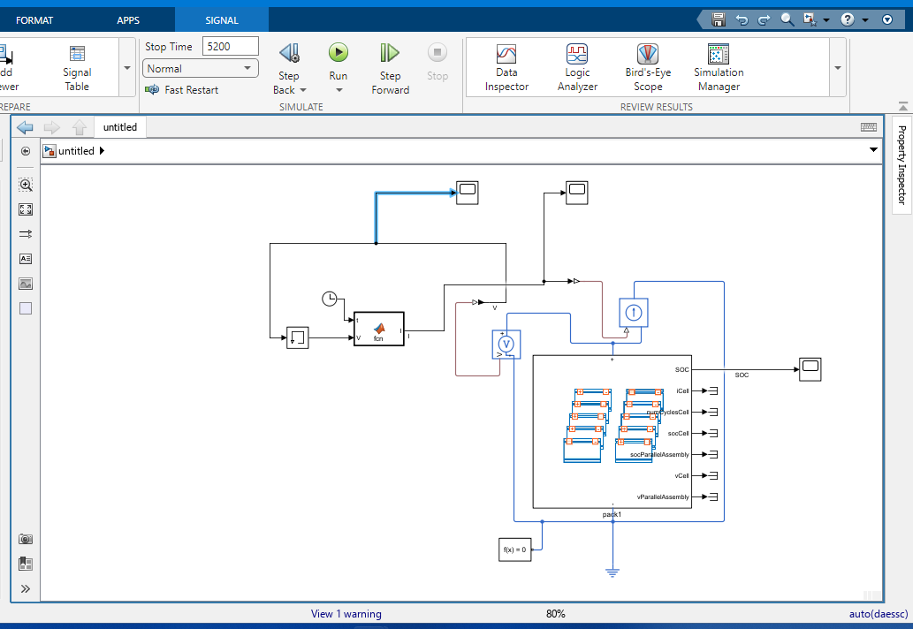
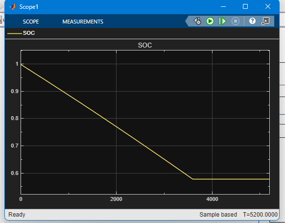
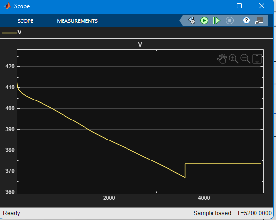
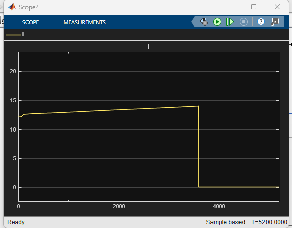

# Battery Pack Model for a Grid-Connected Energy Storage System

A Simscape Battery model of a 10.8 kWh lithium-ion pack, driven by a grid power command through an inverter. Built as part of a 30-day self-study plan on battery management systems (Day 6).

## Pack configuration
| Item | Value |
|---|---|
| Cell | Panasonic NCA463436A (0.68 Ah, 2.448 Wh) |
| Configuration | 100 series x 44 parallel (100S44P), 4400 cells |
| Capacity | 29.92 Ah |
| Energy | 10.77 kWh |
| Nominal voltage | 360 V (about 420 V when full) |
| Cell model | Table-based, one RC pair, lumped model resolution |

## Grid side
A MATLAB Function block turns a grid power command into a pack current command:
- 0 to 3600 s: discharge at 5 kW
- 3600 to 5400 s: rest
- 5400 to 9000 s: charge at 4 kW
- inverter efficiency 97% (battery power = grid power / 0.97 when discharging, grid power x 0.97 when charging)
- current = battery power / measured pack voltage

The current command drives a controlled current source connected to the pack.

## Results
**Model**

**State of charge:** falls from 100% to about 58% during the 1 hour discharge, then holds during the rest.

**Pack voltage:** falls from about 412 V to about 367 V under load, then jumps to about 373 V when the current stops. The jump is the internal resistance drop disappearing.

**Pack current:** about 12.5 A rising to 14 A over the discharge, because power is constant while voltage falls.

## How to run
1. Download all files into one folder.
2. Add the folder to the MATLAB path.
3. Open `grid_pack_model.slx` and press Run (stop time 10800 s).

Required: MATLAB, Simulink, Simscape, Simscape Electrical, Simscape Battery.

## Limitations
- No thermal model and no aging
- Simple inverter model (constant efficiency, DC side only)
- No BMS protection logic yet (voltage, current, and SOC limits)

## Next steps
- Add protection limits and cell balancing
- Add a thermal model
- Add an EKF-based SOC estimator
